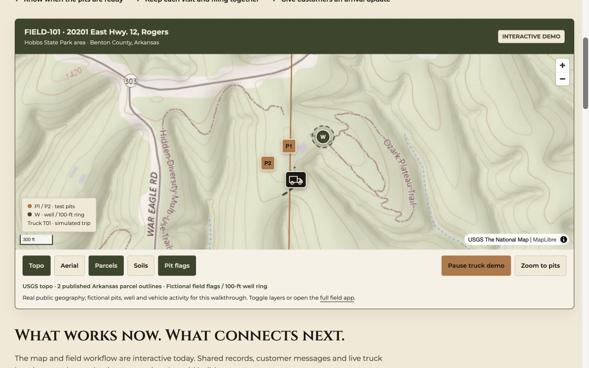

# GIS overview update — November 18, 2026

- Rebuilt `gis-plan.html` around a real MapLibre map, public USGS basemaps and Arkansas parcel queries, plus USDA soil overlay controls.
- The map's pit/well pins and animated truck are fictional walkthrough features at a public address. The well ring is geodesic; the short truck path illustrates motion and is not a calculated road route.
- Added independent controls for base maps, parcels, soils and field flags, a close-up view, animation pause and reduced-motion behavior. External-service failure messages preserve the rest of the page.
- Replaced wide tables with mobile cards and illustrated customer texts as a phone timeline. The rollout distinguishes live preview interfaces from next production integrations.
- Self-hosted Cinzel/Montserrat and their SIL OFL notices; applied the supplied olive/copper/cream brand palette and an undistorted original mark. Added favicons.
- Consolidated implementation details into a collapsed notes section, retained official-source links and added concrete next decisions.
- Tyler is the user's latest confirmed spelling and replaces the previous spelling across current site variants and documentation.
- Tracker amounts are labeled USD planning budgets, not vendor quotes. Live phone/GPS messaging remains a separate integration step.

During local checks the USDA Soil Data Access service returned HTTP 502, so its unavailable state was exercised. Other map controls, actual parcel lookup and field markers remained usable. Responsive browser checks at 390px found no horizontal page overflow; closed notes keep the mobile page substantially shorter than the former document.

Verification: all 111 application checks passed. Fourteen live checks verified source matches, font MIME types and existing private/feedback route protections. Live mobile rendering at 390px measured 6,945px high with a 390px document width and loaded local fonts. No JavaScript errors were observed in the published default map view.

[Published phone layout](screenshots/GIS-Overview-Mobile.png)
