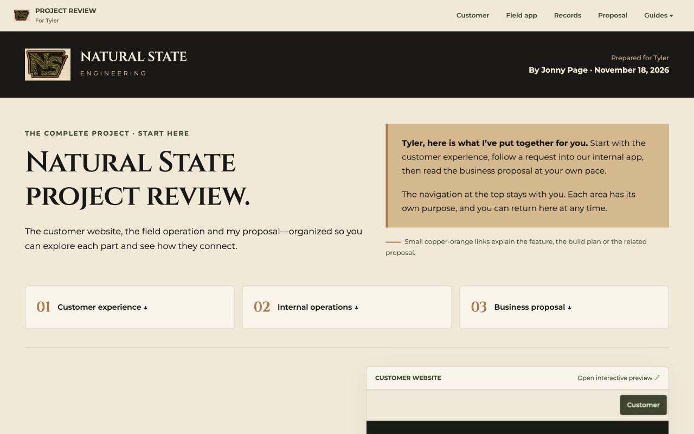

# Unified Natural State review — November 18, 2026

## Start here

https://white-sandpiper-603604.hostingersite.com/

This is the complete partner-review entry point. It links the customer experience, internal app and separate business proposal on the existing full-project domain. The older feedback deployment is retained separately; its visitor sessions and browser-local evidence are not migrated or deleted.

## Backup before the change

GitHub tag: `backup-02-before-unified-review-2026-11-18`, pointing to source commit `750694f0e48957cc3a212eb9f7d9249caf29def4`. The tag was pushed and verified before edits began. Earlier commits remain intact. The tag contains source, assets and documentation; it deliberately excludes credentials, private business records and uploaded customer files.

## Review structure

- `index.html`: complete review hub and links to every current area.
- `engineering.html`: customer website with intake, booking preferences and assistant demonstration.
- `siteworks.html`: separately labeled proposed Siteworks customer concept and fictional inquiry preview.
- `field.html`: complete retained GIS/dispatch/on-site field application.
- `workspace.html`: preview job records, property data and engineering-record views.
- `staff.html`: protected real-records access, with a prominent separate demonstration link.
- `proposal.html?chapter=1` through `chapter=7`: focused proposal chapters with Back/Next, direct links and mobile chapter selection. Existing calculators and the work-order demonstration are retained.
- `platform.html`, `system.html`, `gis-plan.html`, `receptionist.html`: scope, operating details and feature explanations.
- `walkthrough.html`: the former detailed headquarters, retained with its original chapters.
- `review.html`: compatibility entry to the new hub.

The small copper-orange links explain a feature or its related proposal. The fixed review navigator identifies the current area and is separate from the future public customer launch. It is omitted in real-intake mode and on the protected staff page. Proposal terms are review content rather than an executed agreement.

## Existing records and connected demonstration

The PHP session name, cookie path, demo API, database backend, field model and evidence storage keys are unchanged. This update runs no reset or data migration. The customer confirmation now links to both the exact dispatch job and its office record. Only the last demonstration project ID is retained in browser storage for convenient navigation; project contents stay in the existing application. Automatic address matching remains unconfigured and is now labeled rather than offered as an unexplained action.

## Verification

All 111 existing application checks and 13 field HTTP checks passed. Browser verification followed one submitted fictional customer request into its FIELD-104 dispatch record and the matching office record. Proposal chapter navigation, $295 fifth-hour compensation and the existing Siteworks labor/rental/distribution calculation were checked. At 390px, the hub, proposal, customer, field, records, GIS plan, platform, system, receptionist and Siteworks screens stayed within the viewport. The static link audit covers local pages, assets and anchors. Live voice, calendar reservations, vehicle feeds, customer SMS and production archive integration retain their existing activation status.

Live release checks: 31 public-file/access checks and all 13 isolated HTTP workflow checks passed on Hostinger. The published proposal reader, retained field app and 390px hub navigation were also verified in the browser. The temporary upload archive was moved to Hostinger trash after extraction.

[Phone view](screenshots/Unified-Review-Mobile.jpg)
